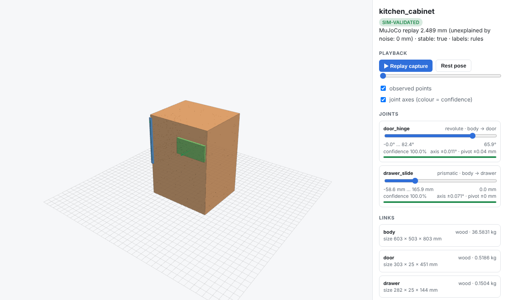

# ObjectModel

**Turn a capture of a real articulated object — a laptop, a cabinet, a desk lamp, a faucet — into a
simulation-ready digital twin (URDF + MJCF) that has been *proven* in a physics simulator.**

```
video / RGB-D / point tracks
        │
        ▼
 rigid-motion segmentation ──► per-part 6-DoF poses ──► joint fitting (fixed / prismatic / revolute, BIC)
        │                                                     │  + bootstrap uncertainty per joint
        ▼                                                     ▼
 kinematic tree (chains & branches) ──► physical properties (OBB, material, mass, inertia)
        │
        ▼
 semantic agent (any OpenAI-compatible LLM, or offline rules) — names parts, picks materials
        │
        ▼
 URDF + MJCF + JSON ──► MuJoCo validation: compile → kinematic replay vs. observations → stability
        │
        ▼
 report.md + interactive viewer.html (joint sliders, replay, confidence-coloured axes)
```



## Why it's different

Most "photo/video → URDF" tools ask a language model to *guess* joint numbers and then trust a
vision-language critic to say it looks right. ObjectModel splits the job the other way round:

| | Typical approach | ObjectModel |
|---|---|---|
| Joint type, axis, pivot, limits | LLM/VLM guesses | **Measured** in closed form from tracked motion (screw-axis fitting, Kabsch, BIC model selection) |
| Number of parts / structure | usually 1 joint, 2 parts | **Any tree**: serial chains (lamp), branches (cabinet with door + drawer) |
| Trust | none, or "critic says OK" | **Per-joint confidence** (type posterior) and **uncertainty** (axis ±°, pivot ±mm via bootstrap) |
| Validation | visual check | **MuJoCo-in-the-loop**: compiles both exported files (URDF and MJCF must agree), drives it with the measured joint states, compares every simulated surface point with the observations, and separates model error from measurement noise |
| Physics | missing / identity inertia | Min-volume boxes, material densities, mass and positive-definite inertia; MJCF in radians with limits |
| LLM | required | Optional, any OpenAI-compatible endpoint (Llama API, vLLM, Ollama…); output is schema-validated, clamped and sanitised; offline rules otherwise |
| Evaluation | demo videos | **Built-in benchmark** with ground truth and standard articulation metrics |
| Moving camera | static rig assumed | **Hand-held capture**: joints are fitted on part-relative motion and the replay runs in the base's frame, so camera ego-motion cancels out |
| Integration | script | CLI, Python API, **MCP server** for agents |

## Quick start

```bash
pip install -e ".[dev]"          # numpy, mujoco, opencv, pytest

objectmodel demo kitchen_cabinet --out out/cabinet
open out/cabinet/viewer.html     # drag the joint sliders, press "Replay capture"
```

```
kitchen_cabinet: SIM-VALIDATED (replay 2.489 mm, unexplained 0.0 mm, noise σ 1.039 mm, stable=True)
  door_hinge             revolute   body -> door  conf=1.000  axis=(+0.00, -0.00, +1.00) ±0.01°
  drawer_slide           prismatic  body -> drawer  conf=1.000  axis=(-0.00, -1.00, +0.00) ±0.07°
  wrote: out/cabinet/kitchen_cabinet.urdf, out/cabinet/kitchen_cabinet.xml, out/cabinet/model.json, ...
```

### Inputs

| Command | Input |
|---|---|
| `objectmodel fit tracks.npz` | 3D point tracks: `points` (T,N,3) metres, `visible` (T,N). Plug in any tracker + depth (CoTracker, SAM-mask tracks + metric depth). `--labels parts.npy` uses your own per-track part ids (e.g. from SAM masks) and skips segmentation. |
| `objectmodel video clip.mp4 --scale-mm 304` | A video. Built-in LK tracking with forward-backward checks and automatic background removal. With `--depth depth.npy` (T,H,W metres) points are back-projected in 3D; without it, side-on (in-plane) motion with metric scale from a printed ArUco marker (`--marker-mm 50`) or one known dimension (`--scale-mm`). |
| `objectmodel demo <object>` | Procedural objects with exact ground truth: `laptop`, `drawer_cabinet`, `desk_lamp` (serial chain), `kitchen_cabinet`, `faucet`, `dresser` (3 drawers + door), `fridge` (mirrored doors). |
| `objectmodel gallery [objects…]` | Reconstruct several objects into one shareable interactive page (object picker, `#name` links). |
| `objectmodel bench` | The benchmark below. |

### Outputs (per object)

`<name>.urdf`, `<name>.xml` (MJCF), `model.json`, `report.md`, `viewer.html` (self-contained).

### Semantic agent (optional LLM)

```bash
export OBJECTMODEL_LLM_BASE_URL=https://api.llama.com/compat/v1   # any OpenAI-compatible endpoint
export OBJECTMODEL_LLM_API_KEY=...
export OBJECTMODEL_LLM_MODEL=...
```

The model only receives the *measured* structure (part sizes, joint types and axes) and returns names,
materials and fill fractions. Geometry is never taken from it. Invalid ids, unknown materials and
out-of-range numbers are dropped; network or parse failures fall back to geometric rules, and the
report says so. `--no-llm` forces offline mode.

### MCP server (for agents)

```json
{"mcpServers": {"objectmodel": {"command": "python", "args": ["-m", "objectmodel.mcp_server"],
                                 "env": {"OBJECTMODEL_ROOT": "/path/to/workdir"}}}}
```

Tools: `list_demo_objects`, `reconstruct_demo`, `reconstruct_tracks`, `reconstruct_video`. File paths are
confined to `OBJECTMODEL_ROOT`.

## Benchmark

`objectmodel bench --seeds 3 --noise 1 3 6 10` — 7 objects (2–5 parts, up to 4 joints) × 3 seeds × 4 noise levels, 5 % per-frame
track dropout. Axis error is the angle between estimated and true axes; pivot error is the distance from
the estimated pivot to the true hinge line; "unexplained replay" is the MuJoCo replay error left after
removing the expected contribution of measurement noise (√6·σ).

| noise | topology | joint type | axis err ° | pivot err mm | state err | unexplained replay mm | sim pass | s/object |
|---|---|---|---|---|---|---|---|---|
| 1 mm | 100% | 100% | 0.18 | 0.2 | 0.0017 | 0.03 | 100% | 1.5 |
| 3 mm | 95% | 98% | 0.69 | 1.0 | 0.0052 | 0.85 | 100% | 1.5 |
| 6 mm | 86% | 93% | 1.35 | 1.6 | 0.0098 | 2.30 | 100% | 1.5 |
| 10 mm | 86% | 90% | 1.58 | 3.8 | 0.0190 | 5.19 | 81% | 1.4 |

By object (all noise levels):

| object | topology | joint type | axis err ° | pivot err mm | sim pass |
|---|---|---|---|---|---|
| laptop | 100% | 100% | 0.63 | 1.6 | 100% |
| drawer_cabinet | 100% | 100% | 0.57 | nan | 92% |
| desk_lamp | 100% | 100% | 1.75 | 2.4 | 92% |
| kitchen_cabinet | 100% | 100% | 0.32 | 0.7 | 100% |
| faucet | 42% | 67% | 2.91 | 3.6 | 83% |
| dresser | 100% | 100% | 0.51 | 0.8 | 100% |
| fridge | 100% | 100% | 0.04 | 1.0 | 100% |

At 1 mm tracker noise every case is reconstructed with the right topology and joint types, a 0.18° mean
axis error and a 0.2 mm mean pivot error; at 3 mm, 20 of 21 cases have the correct topology. Almost all failures
are the faucet's small lever, whose total motion (~13 mm) is close to the noise floor at 3–10 mm.
Separating it would need a longer motion range.

### Hand-held camera

`objectmodel bench --camera-motion 0.3` adds a smooth whole-scene sway (up to 0.3 rad and 15 cm), so no
part is static in the observed frame:

| noise | topology | joint type | axis err ° | pivot err mm | state err | unexplained replay mm | sim pass | s/object |
|---|---|---|---|---|---|---|---|---|
| 1 mm | 100% | 100% | 0.30 | 0.2 | 0.0015 | 0.00 | 100% | 1.5 |
| 3 mm | 90% | 90% | 0.73 | 0.9 | 0.0042 | 1.10 | 100% | 1.5 |
| 6 mm | 76% | 88% | 1.15 | 1.1 | 0.0088 | 2.06 | 100% | 1.4 |

## How it works

1. **Segmentation.** Sequential RANSAC over rigid-motion hypotheses: a spatially local seed set is fitted
   frame-by-frame with visibility-weighted Kabsch, every track is scored by its ~90th-percentile residual
   over time, and the largest consensus set becomes a part. The tolerance adapts to the measured noise
   (σ from second temporal differences) and relaxes progressively for leftover tracks, because real
   trackers drift more on fast-moving parts.
2. **Joints.** For child poses relative to the parent, `M_t = P_t⁻¹ ∘ C_t`:
   *revolute*: axis = null vector of stacked `(R_t − I)`, pivot from least squares on `(I − R_t)p = t_t`,
   angle `θ_t = atan2(½ uᵀ vee(R−Rᵀ), (tr R − 1)/2)`; *prismatic*: top singular vector of the
   translations; *fixed*: identity. BIC with a noise-floor variance picks the model, and the posterior
   is reported as confidence. A frame bootstrap gives axis/pivot uncertainty.
3. **Tree.** The static part is the root (or the largest part when a hand-held camera makes everything move); parts are attached Prim-style by the lowest joint
   residual plus a contact-gap penalty. The composition of two hinges is not a single hinge, so serial
   chains are recovered correctly.
4. **Physics.** Minimum-volume oriented boxes (world, PCA and yaw-swept candidates), a density table,
   fill fractions for hollow parts, and box inertia (always satisfies the triangle inequality).
5. **Validation.** The MJCF is compiled by MuJoCo and driven with the measured joint states
   (`mj_kinematics`). Every simulated surface point is compared with its observed track. Static
   checks cover mass, inertia and limits; each joint is swept through its range to catch parts that
   would collide; a 2 s passive simulation checks stability; and the URDF is compiled in MuJoCo as
   well, with its link poses required to match the MJCF at rest, mid-range and both limits. A model is
   **SIM-VALIDATED** only if all of these pass.

## Twin-to-Task: humanoids that open things

The twin is only useful if a robot can act on it. `objectmodel task` gives a humanoid **only the measured
twin** (handle, motion direction, range) and has it open the object in MuJoCo. The task runs in a
separate world built from the object's **ground truth**, so a wrong twin shows up as the arm fighting
the joint, measured as grasp force above an oracle plan that uses the true joint.

```bash
objectmodel task kitchen_cabinet                  # generic humanoid opens the door and the drawer
objectmodel task kitchen_cabinet --perturb 10     # same plan from a twin with a 10° axis error
objectmodel task-bench --out docs/task_bench.md   # sweep twin error across 10 tasks
bash scripts/fetch_menagerie.sh                   # public Apollo model (Google DeepMind, Apache-2.0)
MUJOCO_GL=egl objectmodel task fridge --robot apollo --video fridge.mp4
```

| Twin used for planning | Tasks that succeed | Median extra grasp force | Worst |
|---|---|---|---|
| Measured twin | 100% | 0 N | 3 N |
| + 2° axis error | 60% | 16 N | 35 N |
| + 5° | 30% | 56 N | 225 N |
| + 10° | 0% | 116 N | 823 N |

How it works:
- **Affordance:** handle, pull or swing, closed end, handle path.
- **Stance:** square to the face for pulls; a grid search over the arc for swings.
- **Inverse kinematics:** damped least-squares IK on the reference pose, with servos tracking it. On
  Apollo this covers torso yaw/pitch plus the 7-DoF arm.
- **Grasp and execution:** a `connect`-constraint grasp at contact, after which the hand follows the
  twin-predicted path of the point it actually holds.

Limits:
- No finger closure.
- The pelvis is held fixed, with no squatting; low furniture sits on a stand for the standing robot.
- No robot-object contact during the task.

Details and role mapping: [`docs/APPTRONIK.md`](docs/APPTRONIK.md).
ObjectModel is an independent project, not affiliated with Apptronik.

## Website and hosted API

The product site lives in `web/` (built from `site/` by `scripts/build_site.py`) with a Python
serverless function in `api/reconstruct.py` that runs the real pipeline. It deploys to Vercel as is
(`vercel.json`: static `web/` with clean URLs, the function with a 60 s limit).

```bash
python scripts/build_site.py            # pages, gallery, samples (SITE_URL=... sets canonical links)
python scripts/dev_server.py 8000       # local preview with the real /api/reconstruct
node scripts/render_media.js            # re-render product imagery from the viewer (needs the dev server)
npx vercel deploy --prod                # deploy
```

Pages: `/` (landing, live replay), `/playground` (run a reconstruction, upload tracks, download files),
`/gallery` (all demo objects), `/docs`, and a 404. The site self-hosts three.js, needs no build step, and
honours dark mode and reduced motion.

## Development

```bash
python -m pytest -q        # 126 tests (+1 Apollo test when the model is installed): math, estimation accuracy, export, validation, agent, video, MCP
```

The research behind the design is in [`reports/`](reports/) with notes in [`research_notes/`](research_notes/).

## Limitations and roadmap

- Box collision geometry only; per-part meshes (convex decomposition) are next.
- Damping and friction can't be identified from kinematics alone and are defaults.
- The built-in video path handles in-plane motion or needs a depth stack. For hand-held monocular
  video, feed tracks from a 3D tracker + metric depth model through `objectmodel fit` (the estimator
  and validator handle camera motion).
- Built-in Lucas-Kanade tracking drifts on large out-of-plane rotations in RGB-D renders
  (`objectmodel/render.py`): the hinge direction is found but the swing is under-estimated, and the
  validator flags the result. Use a long-range tracker's output with `objectmodel fit` for these.
- Planned: screw (helical) joints, marker-based camera pose for hand-held capture, USD export,
  PartNet-Mobility benchmark import.

## License

MIT
